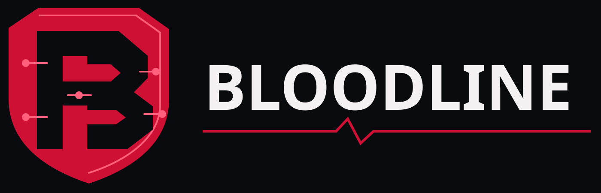

<p align="center">
  
</p>

# Bloodline 2.0

**A bank-side defence against money-mule fraud.** Bloodline checks every payment *before* money leaves the customer's account. If the payee looks like a mule account, the customer gets a warning and a cooling-off pause. Bank staff get tools to trace stolen money through mule rings and act on it.

The repo contains two apps:

| Folder | What it is | Port |
|---|---|---|
| [`bloodline2_project/`](bloodline2_project) | **The detector.** FastAPI service with an XGBoost mule model, Isolation Forest, SHAP reasons, graph features, Money DNA lineage, next-hop prediction, case clock and Business Shield | 8000 |
| [`bloodline_bank/`](bloodline_bank) | **Bloodline Bank.** A demo internet bank that uses the detector: customer net banking and an admin console | 8001 |

> All accounts, transactions and datasets are synthetic. This is a demonstration, not legal or financial advice.

---

## Features

### Customer login (net banking)
- **Everyday banking:** balance, recent activity, payees and statement.
- **Fund transfer with a pre-payment check:** every payee is scanned by Bloodline before money moves.
  - **Medium risk:** a 30-second pause, with the reasons and a "what would make this account look safe" explanation.
  - **High risk:** a 60-second pause.
  - **"Proceed anyway"** stays locked until the pause ends and the customer ticks an acknowledgement. The server enforces the pause, so it can't be skipped from the browser.
  - **Helpline details:** 1930 and the bank fraud desk, one tap away.
- **Blocked accounts:** payments to them are refused.

### Admin login
| Tab | What it does |
|---|---|
| **Live monitor** | Live transaction feed, plus totals for warnings, cancellations, blocks and money protected |
| **Simulation** | Real-time traffic with many payments at once, mule rings (victims pay one mule at the same moment, then it sweeps the money on) and load bursts |
| **Suspicious accounts** | Review every account that received a risky payment: **Flag** (forces at least a medium warning), **Block** (stops payments and places a lien in the detector) or **Ignore** (marks as genuine) |
| **Pre-payment scan** | Live list of detected mules and verified merchants. Shows the risk gauge, SHAP reason bars, counterfactual and predicted next hops, with one-click lien holds |
| **Analyst console** | **Money DNA:** replay how stolen money moved through a ring, by chain, account or transaction. Also a **ledger feed** with "Track money" on every row, and a **mules directory** |
| **Case queue** | Regulatory case clock: 21-day show-cause and 14-day FMR deadlines, with human sign-off on legal steps |
| **Business Shield** | Spots invoices whose payout account was switched away from the vendor's verified account (business email compromise), with hold or release |
| **Impact & ML eval** | Detector impact figures, this bank's live results, and the model's held-out test metrics |
| **Settings** | Medium and high pause lengths, and the risk thresholds |

---

## Run locally (Windows)

Needs Python 3.12.

```powershell
cd bloodline2_project
python -m venv .venv
.\.venv\Scripts\python.exe -m pip install -r requirements.txt
cd ..\bloodline_bank
.\run.bat
```

`run.bat` starts both servers and opens http://127.0.0.1:8001. To start them by hand:

```powershell
cd bloodline2_project
.\.venv\Scripts\python.exe -m uvicorn app.main:app --port 8000
cd ..\bloodline_bank
..\bloodline2_project\.venv\Scripts\python.exe -m uvicorn app:app --port 8001
```

### Logins

| Role | Username | Password |
|---|---|---|
| Customer | any customer account ID, e.g. `ACC00001` | `demo123` |
| Admin | `admin` | `admin123` (also shown on the login page) |

Test payees: `ACC02215` scores high risk, `ACC02228` medium risk, and `ACC02041` (a shop) low risk.

---

## Deploy on Render (free)

`render.yaml` defines two free web services, `bloodline-detector` and `bloodline-bank`.

1. On [render.com](https://render.com), choose **New → Blueprint** and pick this repo, branch `main`.
2. Wait for both to build: about 5–10 minutes for the detector (ML packages), about 1 minute for the bank.
3. Open `bloodline-bank`'s URL and log in with the credentials above.

If the detector's URL isn't `https://bloodline-detector.onrender.com`, set the bank's `DETECTOR_URL` environment variable to the real one. To lock down admin access, change `ADMIN_PASSWORD` under **bloodline-bank → Environment**.

**Auto-deploy:** every push to `main` redeploys only the service whose files changed:

| Change | Redeploys |
|---|---|
| `bloodline_bank/**` | Bank (about 1–2 min) |
| `bloodline2_project/**` code, data or models | Detector (about 5–10 min) |
| `bloodline2_project/data/bloodline.db` | Both |
| Docs, `.md`, notebooks, React source | Nothing |

Free services sleep after about 15 minutes idle. The first visit then takes up to a minute while they wake. Each redeploy resets the bank's balances and activity.

---

## The model

| Piece | Purpose |
|---|---|
| **XGBoost classifier** | Mule probability from 18 point-in-time signals: account age, sender counts, pass-through, dwell time, structuring, dormancy, shared device/IP/phone, graph proximity and loops |
| **Isotonic calibration** | Makes scores real probabilities, so "70%" means about 70% of such accounts are mules |
| **Isolation Forest** | Unusual-behaviour score |
| **TreeSHAP** | Reason codes shown to analysts and customers |

Code is in `bloodline2_project/app/ml/` (`features.py`, `train.py`, `engine.py`); trained files are in `bloodline2_project/data/models/`.

### How it's evaluated
`python -m app.ml.train` uses **5-fold cross-validation with whole mule rings held out**, so every score comes from rings the model never saw during training. Mules and genuine accounts are sampled the same way, and no input can read the label from account names. Results are written to `eval/metrics.json`.

| Measure (out-of-fold, 7,217 samples, 91 mule accounts in 16 rings) | ML model | Rule baseline |
|---|---|---|
| PR-AUC | **0.976** | 0.23 |
| Precision at high band (0.65) | **98.1%** | 29.0% |
| Recall at high band / medium band (0.40) | **90.5% / 97.8%** | 77.2% |
| False-positive rate at high band | **0.06%** | 6.3% |

### Testing on your own data
| Script | Use it for |
|---|---|
| `eval/evaluate_profiles.py <dataset.json>` | An account-profile dataset (no transactions). Scores it with the detector, trains and tests a profile model inside it, and with `--pretrained` tests a model trained on another dataset. Writes `eval/profile_report_<name>.json/.md`. |
| `eval/cross_dataset.py <a.json> <b.json> ...` | Leave-one-dataset-out: train on all but one dataset, test on the one left out, rotating. Writes `eval/cross_dataset_report.json/.md`. |
| `data/ingest_custom.py --dir <folder> --db <new.db>` | Load your own accounts and transactions (CSV or JSON) into a separate database. It replaces the target database, so always use a new `--db`. |

**Known limit:** the transaction-based detector needs transaction history. On profile-only datasets it flags almost everyone. A profile-based model trained on several such datasets reached about 94–95% accuracy on a held-out dataset.

---

## Project structure

```
bloodline2_project/
  app/            FastAPI detector: API routes, ML engine, services (lineage, cases, vendor, scoring)
  data/           bloodline.db synthetic ledger, trained models, ingest and simulator scripts
  eval/           metrics.json and evaluation scripts
  scripts/        reset_dataset.py, bank_server_simulator.py
  tests/          pytest suite (30 tests): .venv\Scripts\python.exe -m pytest tests
  frontend/src/   original React console source (needs pnpm build)
bloodline_bank/
  app.py          bank backend: logins, transfers, cooling-off, simulation, admin API, detector proxy
  static/         index.html (whole UI) and logo.svg
render.yaml       Render blueprint for both services
```

## Design

**Midnight Crimson** dark theme. The tokens are in `bloodline_bank/static/index.html`:

| Token | Value |
|---|---|
| `--bg-primary` | `#090B0E` |
| `--bg-surface` | `#181C23` |
| `--text-heading` | `#F5F1F2` |
| `--text-muted` | `#ADB4C0` |
| `--color-primary` | `#CF1035` |
| `--color-highlight` | `#FF607B` |

The logo is in `bloodline_bank/static/logo.svg`; the wordmark uses Rajdhani.

## License

MIT. See [`bloodline2_project/LICENSE`](bloodline2_project/LICENSE).
