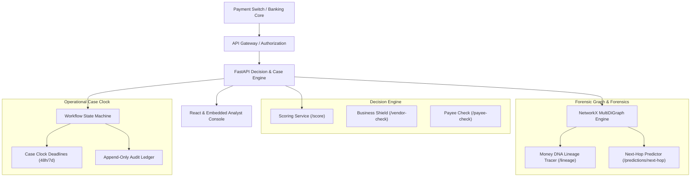

# Bloodline 2.0 System Architecture

## Overview
Bloodline 2.0 is a decision-support platform designed for banks and payment service providers to detect, trace, and preempt mule accounts and synthetic financial laundering syndicates.

## Graph Semantics
The graph is maintained as a directed multigraph $G = (V, E)$:
- **Nodes $V$**:
  - `account`: Core transacting account with balance, account age, and mule index.
  - `device`: Hardware device fingerprint linking ostensibly independent accounts.
  - `ip`: IP subnet / VPN exit node.
  - `phone`: Shared contact number.
  - `honeypot`: Internal decoy sinkhole.
- **Edges $E$**:
  - `TRANSFERRED_TO`: Multi-edge retaining unique transfer ID, timestamp, currency, channel, and status (`COMPLETED`, `HELD`, `CANCELLED`).
  - `USED_DEVICE`, `USED_IP`, `USED_PHONE`: Infrastructure associations (uncertain investigative signals).
  - `PREDICTED_NEXT_HOP`: Predicted candidate destinations represented with distinct dashed styling.

## Attribution Boundaries
- **Prototype Boundary**: All evaluations use synthetic data.
- **Proportional Tracing Assumption**: Money DNA allocations are attribution assumptions based on proportional fund-flow mechanics, not legal determinations of guilt.
